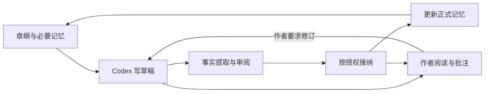

# SpecWriter

面向 Codex 的长篇小说创作工作流。作者提供想法、授权和阅读意见，Codex 通过 Skills 规划、写作与修订，WriterMemory 保存有正文证据、可追溯且带章节边界的长期记忆。

**v0.11 将历史核查接入计划、独立审阅、修订、阶段回顾和完结。** 作者仍只需要 `$specwriter`；新增 recap/finish 两个辅助 Skill，共13个入口。Codex 实际核对正文和出处，保存当前版本的判断，再按作者选择推进；准备资料不表示审阅完成。验证范围见 [v0.11 报告](docs/v0.11-lifecycle-validation.md)，研究资料与题材方法见 [v0.10 记录](docs/v0.10-research-validation.md)。真实长篇质量尚未验证。

## 作者怎么使用

作者通常只需要 `$specwriter` 总入口和自然语言。内部的章纲 JSON、事实提取、审阅记录和 CLI 命令由 Codex 操作。下面用一部河镇悬疑小说演示完整的开篇流程。

### 1. 安装并打开小说目录

下载源码或取得本项目安装包后，把 [install.md](install.md) 交给 Codex，发送：

```text
请按 install.md 实际安装和验证 SpecWriter。复用已有环境及凭据文件，
小说目录使用 E:\novels\my-book。允许准备必要依赖，并进行一次小请求模型连通检查。
安装后告诉我打开哪个目录、怎么开始写作和阅读，先不要写正文。
```

安装指南包含 Microsoft GraphRAG、Qwen、本地 Ollama BGE-M3 和 Git 备份配置。本项目尚未发布到 npm，源码或 tgz 的安装方式以指南为准。模型连通探测可能产生少量费用。

安装后在 Codex 中打开 **`E:\novels\my-book` 小说目录**。Skills 位于该书的 `.agents/skills/`；已有会话若未发现新 Skills，重新打开目录或开启该目录的新会话。

### 2. 先构思和规划，不写正文

```text
$specwriter 帮我构思一部长篇河镇悬疑小说。
主角阿宁带着母亲留下的旧灯去寻找失踪的姐姐，使用第三人称限知视角。
先整理故事主线、世界规则、人物和文风，再规划开篇三章。
给我看方案，暂时不要写正文。
```

Codex 用 explore/propose 整理四份创作约定和近期计划，并完成对应历史核查。新书没有既有正文，不调用 GraphRAG 补造历史；已有小说核对当前有效材料和出处。作者先选定方案，Codex 再采用约定版本、建立有章节范围的工作包。全书大纲是方向，近期场景可以细化；未来计划不会作为已发生事实进入记忆。

也可以先让 Codex 做研究或学习写法，再决定方向：

```text
$specwriter 调研番茄和起点当前公开榜单中的悬疑方向，
记录来源、时间和实际可见范围，给我几种不同的读者承诺与原创选题。
结合悬疑推理方法，说明适合我的慢热河镇故事的部分，先不改设定或写正文。
```

```text
$specwriter 分析我提供的开篇三章材料，标明只读到哪里，
解释场景、对白和信息揭露怎样推进；提炼可迁移机制，
为我的人物和世界提出原创改法，不搬用原作表达或标志性情节。
```

当前市场信息使用 Codex 实际可用的联网搜索/浏览工具。CLI radar 仅抓公开榜单快照，不需额外搜索 API Key，也不是 Qwen 搜索能力；没有联网工具或页面无法访问时报告来源不足，可用作者文件/摘录，不编造最新数据。内置玄幻升级、都市职业、悬疑推理、言情关系、历史权谋方法是可定制原创经验，不声称热榜实证。作者选定做法后才整理并采用 Specs，报告不会自动变成约定或小说事实。见 [研究协议](packages/specwriter/assets/research.md)。

### 3. 采用方案，先看第一章草稿

```text
$specwriter 采用当前方案。把开篇三章作为一个工作包，
本次只写第一章草稿，目标约 3000 字，先不要接纳为正式正文。
完成章纲、取回必要记忆、写作、事实提取和审阅，再打开草稿阅读器。
```

Codex 记录第 1 章的 draft 授权，完成 plan 核查、结构化章纲并准备上下文，再写草稿、提取事实和实际审阅。首章没有历史正文，跳过模型记忆检索；后续章节默认索引和检索已接纳前缀。当前章 review 默认复用有效 context，出现新疑点才追加检索。Qwen 用于 GraphRAG 索引与查询，正文仍由 Codex 创作。

**第一章尚未接纳时，不能继续准备第二章。** 后续章节依赖前一章的正式记忆。因此“先看草稿”按章进行；若要连续写三章，应明确授权逐章审阅通过后接纳。

### 4. 阅读、批注并修改草稿

阅读器支持章节切换、字号/行距、夜间模式、阅读进度、版本对照和段落批注。阅读与批注不调用模型。写作完成后刷新正文即可看到最新版本。

在阅读器保存意见，按“复制给 Codex”粘贴到小说对话，或直接发送：

```text
$specwriter 按我在阅读器中对第一章的批注修订草稿。
保留渡口冲突，但不要让阿宁提前知道灯柄缺口的用途。
重新提取事实并审阅，先把修改后的草稿给我看，不接纳。
```

批注不自动发消息或改正文。复制请求带小说身份；Codex 核对目录与版本后记录采纳、拒绝或待澄清及理由。采纳意见进入目标章资料包与审阅，正式接纳后记录落实版本；只完成草稿仍待接纳，作者刷新页面查看。

“已落实”是该工作包和修订版本的历史证明。要求以后所有修订都遵守时，Codex 应另存书籍 instruction 或采用新的 Specs；局部批注不会自动变成永久约定。

勾选“先处理再继续”的意见在下一次 CLI 推进检查阻止后续；不会实时中断正在生成的 Codex 内容。精确采纳目标章允许修订，其余后续等待落实。过期意见先重新定位，人工处理标记不绕过门禁。见 [阅读协议](packages/specwriter/assets/reader.md)。

### 5. 接纳第一章，授权连续写后两章

```text
$specwriter 接纳修改后的第一章。
继续写第 2 至第 3 章，允许每章完成提取、审阅和 verify 后自动接纳。
遇到阻塞矛盾时先停下处理，不越过第 3 章；我随时会提出修改意见。
```

Codex 按实际授权逐章执行下方循环，到第 3 章边界停止。已给授权不重复确认；需要作者判断的问题、暂停、阻塞批注或用量限制仍会停止。具体要求另保存有范围的 instruction，授权理由不代替创作指示。



### 6. 暂停或换会话后继续

```text
$specwriter 暂停当前工作包，我先审阅已有章节。
```

暂停会保存到本书，阅读和审阅仍可用。新会话中可以先恢复状态：

```text
$specwriter 从当前小说目录恢复进度，告诉我已接纳到哪章、
当前停在哪一步、有没有待审阅草稿或过期后文，先不要继续写。
```

作者明确要求恢复后，Codex 才解除暂停，在已有或新授权的范围内继续。`resume` 读取本地文件和记录，不依赖旧聊天，也不调用模型。

修订已经接纳的旧章时，Codex 创建修订工作包。旧章重新接纳后，后续记忆标记为需重审，按授权顺序核对；不能直接把过期后文作为最新小说导出。

### 7. 回顾这一段、导出作品并备份

```text
$specwriter 回顾开篇三章的计划执行情况与遗留线索，归档已完成的工作包。
导出当前连续有效的正式正文为 TXT、Markdown 和 HTML，并保存 Git 检查点。
再给我第 4 至第 6 章的计划，先不写新章。
```

Codex 用 recap 对已接纳范围完成历史核查和阶段报告，记录计划落实、人物/局势变化、伏笔与未决问题；来源与版本绑定，可重新查看。归档只关闭该工作包，不代表整本小说完结。导出位于小说目录 `exports/novel.{txt,md,html}`，只包含连续有效的正式章节；HTML 关闭阅读服务后仍可打开。

全书写完后可以请求：

```text
$specwriter 对当前全书做完结检查，核对整体承诺、人物结局和未决线索，
给我有正文依据的报告。需要我决定的开放问题单列，先不要确认完结。
```

作者选定处理方式并明确确认当前版本完结后，Codex 才记录完成。开放结局可按作者真实选择保留，不自动改伏笔或正文；新章、返修或相关输入变化后旧证明失效，需重新检查。完结不是后台写作服务，也不能证明文学质量。详见 [生命周期核查](packages/specwriter/assets/lifecycle.md)。

启用 `version init` 后，每次接纳自动保存本书独立的 Git 检查点。单独改动设定、批注或归档工作包后再 `version save`；异地备份可导出 bundle。恢复到新目录，模型配置和索引需重新配置/构建，步骤见 [版本与备份](packages/specwriter/assets/versioning.md)。

## 本章上下文怎么组成

第 N 章重放第 1 至 N−1 章连续有效正式记忆，选入采用的四份 Specs、当前 proposal/章纲、适用作者指示、采纳批注、已完成的 plan 核查、显式选中研究的报告/必要引文/来源元信息、必要人物状态/余额/事件/伏笔、上章结尾和 GraphRAG 原文引用。review/impact 独立保存，后文影响材料不进入目标章写作上下文。章纲 references 与计划路径分开，最多选择8份本书已保存报告并写明用途；研究资料条目受预算保护并纳入 context hash，完整捕获原文按来源路径读取核对。研究、外部作品、计划与草稿不进默认 GraphRAG 语料；旧章变更使后文需重审，不能用于当前正式记忆。久远线索可追加查询与原文核对。

这些内容写到 context.json，由 Codex 按 Skill 实际读取。CLI 校验资料版本、审阅与接纳，不会强制清空/注入模型上下文，也无法证明读完材料。GraphRAG 来源可定位不代表每句推断正确，仍需 Codex 和作者核对。

新要求应保存 instruction，再刷新本章资料并重审，例如：

```text
$specwriter 从第二章开始直到开篇结束，暂时不要揭露灯柄缺口用途。
把要求保存到当前工作包的作者指示，更新章纲与上下文再继续。
```

书籍指示追溯已接纳章节时，受影响范围需按授权重审；单纯改 Spec 草稿不改变采用约定。详见 [创作流程](packages/specwriter/assets/workflow.md)。

## 小说目录里有什么

| 位置 | 作者看到的内容 |
| --- | --- |
| `specwriter/specs/` | 故事前提、世界、人物、文风；采用版本另存于本书记忆库 |
| `specwriter/plans/` | 全书方向和近期计划 |
| `specwriter/research/` | 市场、拆书与方法报告草案、来源快照及已保存版本 |
| `specwriter/memory/tasks/` | 各阶段历史核查的请求、资料包与实际判断版本 |
| `specwriter/story-audits/` | 阶段回顾与全书完结检查报告 |
| `specwriter/completion/` | 作者确认的完结证明及动态有效性依据 |
| `specwriter/work/<id>/` | 本轮意图、章节章纲、上下文、提取与审阅记录 |
| `manuscript/drafts/` | 可审阅草稿 |
| `manuscript/chapters/` | 已接纳正文的文件投影 |
| `specwriter/feedback/` | 版本绑定批注、取舍理由和正式落实版本 |
| `specwriter/memory/views/` | 可阅读的人物、状态、认知、事件、资源和伏笔记录 |
| `exports/` | 可交付的 TXT、Markdown 和 HTML |
| `.specwriter/` | 本书正式记忆库、GraphRAG 数据、启动器和独立 Git 检查点 |

每本小说的正文、记忆、索引、授权和批注独立；Python 环境、Ollama 和 BGE-M3 模型可共用。阅读器负责阅读与批注，正文修改由 Codex 完成。

## 想自己运行命令时

在小说目录运行。`opening` 是示例工作包 ID，请以 `status` 输出的实际 ID 为准：

```powershell
Set-Location -LiteralPath 'E:\novels\my-book'
node .specwriter/bin/specwriter.mjs resume --json
node .specwriter/bin/specwriter.mjs status --json
node .specwriter/bin/specwriter.mjs read
```

需要草稿预览、导出或检查点时按需运行，不必把整段一次执行：

```powershell
node .specwriter/bin/specwriter.mjs read --draft --work opening
node .specwriter/bin/specwriter.mjs export --format html
node .specwriter/bin/specwriter.mjs version status
node .specwriter/bin/specwriter.mjs version save --message "开篇三章已归档"
```

`read` 会持续运行本地服务，打印地址并打开浏览器，Ctrl+C 停止。在其他终端执行后续命令。完整命令见 [CLI 文档](packages/specwriter/README.md)，不要仅靠 CLI 命令期待自动生成正文。

总入口 `$specwriter` 协调十二个专项 Skills：research（市场调研）、analyze（拆书）、craft（题材方法）、explore（构思）、propose（规划）、write（写章）、review（审阅）、revise（修订）、commit（接纳）、recap（阶段回顾）、finish（完结检查与确认）、archive（归档），共13个。Codex 根据作者意图路由，不要求作者记住内部名称。使用说明见 [创作流程](packages/specwriter/assets/workflow.md)。

## 开发者快速体验

源码开发要求 Node.js 24+。在源码根目录安装和构建；小说放到独立目录。Windows 使用 npm.cmd：

```powershell
npm.cmd ci
npm.cmd run build
node packages/specwriter/dist/cli.js init E:\novels\my-book --name "我的小说"
```

默认记忆后端是 Microsoft GraphRAG，需按 [安装指南](install.md) 配置 Python、Qwen 和本地 BGE-M3。只有显式选择离线体验时才在 init 加 `--backend local`；local 仍可练习结构化流程，但不做模型语义检索；这不表示 Codex 创作本身离线。

也可以重放随源码提供的三章原创短篇流程演练，目标必须是一个不存在的新目录：

```powershell
node packages/specwriter/examples/author-journey.mjs E:\experiments\specwriter-journey-01
```

该演练会创建独立书籍、写入固定的示例正文和逐章审阅、验证暂停后恢复、接纳和三种格式导出。它使用显式 local 模式，不调用 Qwen，不自动创作新小说，不是文学盲评或长篇召回评测。已有目录会拒绝覆盖。旧 `demo` / `demo:long` 是旧流程夹具，新工作流优先看此演练。

开发检查：

```powershell
npm.cmd test
npm.cmd run check
```

## 当前范围与后续工作

当前有13个 Codex Skills、全流程历史核查、阶段回顾与版本绑定完结证明、可追溯研究库与公开榜单抓取、五类原创题材方法、结构化约定与章纲、独立作者指示、批注取舍与落实追踪、带证据的正文/记忆提交、默认 Microsoft GraphRAG、导出与独立 Git 备份。连续写作由 Codex 在授权范围内执行，没有独立无人值守写作服务。

已有小说整本导入、3–6 万字远距离依赖和百万字验证仍未完成。阶段回顾、完结和历史核查需要 Codex 实际审阅；规则校验和引用可定位不能证明语义判断或文学质量正确。后续按 [优化方案](docs/long-form-optimization-plan.md) 推进。

- [安装与配置](install.md)
- [完整创作协议](packages/specwriter/assets/workflow.md)
- [历史核查、阶段回顾与完结](packages/specwriter/assets/lifecycle.md)
- [研究、拆书与题材方法](packages/specwriter/assets/research.md)
- [记忆记录与 GraphRAG](packages/specwriter/assets/memory.md)
- [阅读、批注与导出](packages/specwriter/assets/reader.md)
- [实验与质量评估](packages/specwriter/assets/benchmark.md)
- [架构与数据边界](docs/specwriter-architecture.md)
- [v0.11 验证范围](docs/v0.11-lifecycle-validation.md)
- [v0.10 历史验证](docs/v0.10-research-validation.md)
- [v0.9 历史验证](docs/v0.9-workflow-validation.md)
- [v0.8 历史验证](docs/v0.8-workflow-validation.md)
- [复用代码与许可证](packages/specwriter/THIRD_PARTY_NOTICES.md)

## 源码目录

```text
SpecWriter/
├── packages/specwriter/
│   ├── src/          # CLI、WriterMemory、GraphRAG 与阅读服务
│   ├── assets/       # Skills、协议、模板与阅读器
│   ├── schemas/      # 章纲、提取与审阅契约
│   ├── examples/     # 工作流演练及兼容检查
│   ├── test/         # 回归测试
│   └── licenses/     # 复用许可证
├── docs/             # 架构、优化方案与验证记录
├── install.md
├── package.json
└── package-lock.json
```

运行依赖、编译产物和本地实验不纳入 Git；小说数据由 init 在独立小说目录创建。
