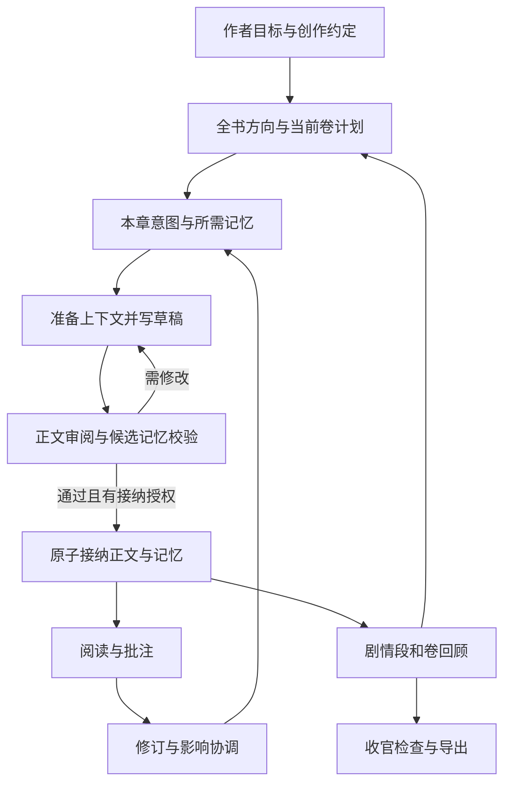

# SpecWriter 长篇小说工作流与记忆优化方案

本方案以当前 v0.7 为起点，把创作约定、滚动规划、正文生成、审阅、长期记忆、阅读反馈和恢复连接成可验收的长篇写作流程。实施顺序是先让 Codex 通过 Skill 稳定完成真实连续创作，再验证 GraphRAG 是否在相同质量下减少检索成本、提高远距离信息使用能力。

本文描述待实施设计，新增文件、字段和命令均不是当前已提供的能力。目标是让作者通过自然语言或一个总入口 Skill 使用完整流程；内部 CLI 负责可验证的边界，Codex 负责创作与语义判断。

## 1 产品范围与交付目标

保留已经确定的产品边界：先支持新建小说；阅读器提供阅读、草稿预览、批注和版本比较，由 Codex 修订；连续写作在作者授权的范围内进行，作者可以审阅和干预。Microsoft GraphRAG 继续作为默认语义检索后端，Qwen 负责其生成任务，本地 BGE-M3 提供稠密向量。

交付目标是作者能够从建书一直推进到完本，并在换会话、预算停止、索引失败和旧章返修后找到明确的恢复动作。工程验收要求正式正文中没有尚未解决的已知阻断问题，不能把工具通过等同于文学质量或绝对不会出错。

本轮不增加独立无人值守写作服务、通用多 Agent 框架、Web 正文编辑器、旧小说导入或章节重排。参考项目内部采用多个创作角色；SpecWriter 把规划、写作和审阅落实为 Codex 的不同任务阶段，不以增加进程或模型角色为前提。

## 2 参考项目的完整创作过程

参考版本固定为 InkOS `8fc2ae57080b9821257dee3e37cc677e2b6f389a` 和 ainovel-cli `638ca2445969b055a1013fedf8bf41c9d0b65c2a`，避免把不同版本的设计混用。

### InkOS

长篇入口先建立作品基础与创作资料，再按目标生成章节意图和备忘，将选中的上下文交给写作环节。规划会保留上一章结尾，帮助场景接续。正文生成后产生审查观察，再以最终正文重建状态，并校验状态变更后保存章节和相关产物。[长篇入口](https://github.com/Narcooo/inkos/blob/8fc2ae57080b9821257dee3e37cc677e2b6f389a/packages/core/src/harness/tools/longform-production.ts)、[章节规划](https://github.com/Narcooo/inkos/blob/8fc2ae57080b9821257dee3e37cc677e2b6f389a/packages/core/src/agents/planner.ts)、[章节执行](https://github.com/Narcooo/inkos/blob/8fc2ae57080b9821257dee3e37cc677e2b6f389a/packages/core/src/pipeline/runner.ts)

记忆选择围绕当前目标，从章节摘要、卷摘要和未关闭伏笔中挑选相关内容，SQLite 是可重建的检索投影。伏笔规则区分重复提及与实质推进，并表达兑现时间范围。低优先级上下文可以语义压缩，保护内容不交给该压缩器。[记忆选择](https://github.com/Narcooo/inkos/blob/8fc2ae57080b9821257dee3e37cc677e2b6f389a/packages/core/src/utils/memory-retrieval.ts)、[伏笔与状态规则](https://github.com/Narcooo/inkos/blob/8fc2ae57080b9821257dee3e37cc677e2b6f389a/packages/core/skills/inkos-long-writing/references/state-projection.md)、[上下文编译](https://github.com/Narcooo/inkos/blob/8fc2ae57080b9821257dee3e37cc677e2b6f389a/packages/core/src/agents/semantic-context-compiler.ts)

这里借鉴章节目标驱动、最终正文驱动状态、保护上下文和伏笔生命周期。其语义选择会接收全部候选，不能据此假设百万字时开销恒定；审查观察也不等于我们的正式接纳门槛。

### ainovel-cli

创作事实决定下一步：建立基础与大纲，展开当前卷弧，规划并写章，提交正文和事实，到段落边界评审、生成摘要、返工，再展开下一段。正文对计划的偏离经过持久化反馈进入后续规划。进度、产物和检查点让恢复不依赖原聊天历史。[运行架构](https://github.com/voocel/ainovel-cli/blob/638ca2445969b055a1013fedf8bf41c9d0b65c2a/docs/architecture.md)

上下文将当前任务、计划、近期正文、角色状态、伏笔、卷弧摘要和待修问题组合起来，压缩后重新注入恢复资料。自动推进与逐章审阅是独立运行政策，许可、暂停和提交恢复分开处理。[上下文管理](https://github.com/voocel/ainovel-cli/blob/638ca2445969b055a1013fedf8bf41c9d0b65c2a/docs/context-management.md)、[章节推进控制](https://github.com/voocel/ainovel-cli/blob/638ca2445969b055a1013fedf8bf41c9d0b65c2a/docs/chapter-advance-gate.md)

这里借鉴事实驱动的下一步、卷弧回顾、滚动展开、任务恢复和有限范围的连续写作政策。Codex Skill 不控制 Codex 内部上下文压缩或完整运行引擎；我们通过持久化恢复包和阶段门槛实现相同的业务目的。

### 适配后的共同流程

两个项目给出的共同启示是：长期创作需要反复执行规划、写作、审阅、状态结算与再规划。仅有查询历史的能力，不能形成这个闭环。

## 3 当前实现与实验基线

代码基线为 `bbff5c3`，包版本为 0.7.0。当前保留的资产如下。

| 部分 | 当前能力 | 下一步衔接缺口 |
| --- | --- | --- |
| 安装与项目初始化 | install.md、模型预设、诊断、独立小说目录 | 新用户完整创作验收与升级迁移 |
| Spec 与计划 | 四份 Spec、计划文件、proposal、intent | 明确采用版本、结构化章纲、卷与剧情段边界 |
| 写章闭环 | prepare、delta、review、verify、commit、archive | 阶段恢复、有限授权与边界回顾 |
| 正式记忆 | 证据、版本、实体、状态、事件、资源、认知、伏笔 | 必选记忆规则、分层回顾、认知获取与伏笔推进细化 |
| GraphRAG | 前缀隔离、增量、缓存、引用映射、用量限制 | 与正式身份对齐、任务查询、成本与质量对照 |
| 阅读与修订 | 阅读、批注、版本差异、旧章失效与逐章协调 | 批注处理理由和对应修订版本 |
| 版本管理 | Git 检查点、备份状态、恢复到新目录 | 新增控制记录与派生摘要纳入一致性检查 |
| 评测 | 四组索引实验、人工评分绑定 | 真实提取、续写、审阅拦截、恢复和规模评测 |

现有实验应分开解释：

- `.specwriter-experiments/20261011-v06/report.md` 是五章十二问、四组共 48 个案例的离线编排实验。占位回答不能作为语义正确率或 Token 节省结果。
- `qwen-bge-m3-20261011` 留有单章失败索引；`qwen-bge-m3-20261011-r2` 留有单章成功索引与查询记录。r2 用量账本有七次操作，其中五次用量不完整，包含失败与重复建库。成功索引约 114 至 139 秒，成功查询约 36 至 41 秒。这些是该环境的连接与兼容性观察，不是长篇性能结论。
- r2 的两份持久化回答记录针对同一资源问题，分别有零条和六条可映射来源；存在引用不证明答案语义正确。尚无完整盲评或真实 Codex 连续写作质量报告。
- 现有预算能力已在 v0.7 实现；benchmark.md 末尾把自动 Token/金额限制列为待实现的文字需纠正。仍未完成的是完整用量覆盖、预算与实验贯通，以及真实费用核对。

优化实验必须复用这套索引基线，并额外建立写作基线；不能把冷启动、缓存和增量三个索引组直接当成三个小说质量方案。

## 4 信息职责与正式数据边界

| 信息 | 权威与生产者 | 消费者 | 更新规则 |
| --- | --- | --- | --- |
| 作者采用的创作约定 | CLI 保存采用版本；Codex依据作者指令整理 | 规划、上下文、审阅 | 变更有范围与版本，历史正文不自动重写 |
| 未来计划与章纲 | Codex生成候选，CLI校验和绑定 | 规划、写作、审阅 | 不成为已发生事实 |
| 正式正文与事实 | SQLite 接纳的 revision 与 delta | 阅读、检索、回顾、恢复 | commit 原子保存，修订保留历史 |
| 角色认知 | 正文证据支持的认知记录 | 写作与视角审阅 | 不把世界事实自动赋予人物 |
| 段落和卷回顾 | 对正式 revision 的派生摘要 | 后续规划和上下文 | 绑定来源版本，修订后失效 |
| GraphRAG 图与回答 | 已接纳正文的派生索引与检索记录 | 检索与审阅 | 不覆盖正式事实，引用回到正文 |
| 授权、暂停与进度 | 每书持久化控制记录 | CLI门槛与Skill | 与故事事实分开，不由批注文本隐式改变 |
| 阅读反馈 | 作者批注和处理记录 | 修订与阅读器 | 绑定原文及修订版本 |

继续以一个小说目录、一套 SQLite 正式数据和独立检索空间隔离作品。候选工件可编辑；采用或接纳后的快照不可变。Markdown 为作者阅读与讨论保留，机器字段由 CLI 校验；新增投影不能形成另一套可互相覆盖的正式数据。

Spec 可约束尚未写出的世界设定，但不证明某事件已经发生。未登记事实表示缺少记录，不自动表示人物不知道、事实不存在或角色记错了。

## 5 从作者入口到完本的目标工作流

| 阶段 | 作者表达 | Skill 与 CLI 的工作 | 输出与下一步条件 |
| --- | --- | --- | --- |
| 建书 | 写一本某题材长篇，给定读者与规模 | 初始化、诊断，确定核心承诺与硬边界 | 四份创作约定和待决问题；明确当前采用内容 |
| 规划 | 先写开篇或当前卷 | 保留全书方向，细化当前剧情段，建立授权范围 | 卷计划、剧情段计划、工作包与运行政策 |
| 计划本章 | 继续下一章 | 读正式状态和上一章结尾，形成结构化意图 | 人物、视角、场景目标、承接事件与伏笔 |
| 取回记忆 | 由Skill自动完成 | 固定章纲，编译必选上下文，再检索补充资料 | 绑定章纲、Spec版本、正文边界和证据的context |
| 写作 | 按已授权范围连续写 | Codex生成可读草稿，缺少关键依据时追加读取 | 草稿落盘，未接纳时不改变正式记忆 |
| 审阅与修订 | 作者可审阅，也可预先授权接纳 | 核对正文、计划、认知和提取覆盖；修订后重提取 | 当前正文的delta与review；阻断问题已解决 |
| 接纳 | 明确接纳或已有范围授权 | verify后原子commit，再投影与备份 | 正式章节和记忆同步；失败有明确恢复状态 |
| 段落回顾 | 按预先约定边界自动执行 | 回顾主线、人物变化、伏笔与计划偏离 | 有来源的摘要和下一段计划建议 |
| 阅读与返修 | 阅读、批注，要求修改 | 定位版本，改正文，协调后续失效记录 | 作者能看见每条意见的处理结果 |
| 收官 | 准备完本 | 检查核心承诺和选定收官范围，修订与导出 | 完本审阅、正式导出与Git检查点 |

全书规模是计划参数，不是一次无限写作授权。作者已经允许某个范围内连续写作和接纳时不逐章重复询问；写到范围末尾、用户指定审阅点、预算限制或未解决阻断问题时停止推进。

## 6 创作约定与结构化章纲

新增轻量创作约定登记：`id`、类型、适用范围、内容、采用版本、采用依据。硬约束与创作目标分开；简单封闭条件由代码检查，人物动机和文学表现由 Codex 审阅。修改草案不自动替换已采用版本。作者已明确采用或授权整理时直接记录，不增加重复确认。

当前四份 Spec 模板保留，只增加采用状态与变更引用。规划仍采用滚动细化：全书保留结局方向和主要承诺；当前卷保留矛盾、人物变化与阶段目标；当前剧情段细化近期场景。范围由作者决定，避免一开始生成数百章细纲。

章纲新增结构化候选 `intent.json`，`intent.md`保留可读表达。至少记录：章节、剧情段、目标、出场实体ID、视角、故事时间表述、场景冲突、必须承接的事件和伏笔ID、需要读取的状态/物品、禁止提前揭露的信息、长度目标和预计章末变化。预计变化只能用于写作与审阅。

解决当前先prepare再填写intent导致重复准备的问题：先提供本章计划种子，包括有效约定、当前计划、相关正式状态与上一章结尾；Codex填写章纲，经CLI校验后再完整prepare。只有实际修改章纲才refresh，不为更新哈希机械重复检索。

旧小说继续读取原有intent.md；新契约升级后绑定结构化章纲与可读投影的版本，禁止双向自由编辑造成分歧。

## 7 分层叙事回顾

新增剧情段与卷的范围登记，并区分未来计划和已发生回顾。回顾记录至少包含范围、正文revision清单及哈希、关键事件引用、人物变化、推进/遗留伏笔、当前矛盾、计划偏离及其处理。

回顾由Codex依据正式正文和正式记忆生成候选，CLI保存来源绑定。摘要是检索与规划的压缩资料，不能新增世界事实，也不能替代关键状态账本。需要精确事实时回到原事件与正文。

在剧情段结束、卷结束及作者指定节点触发回顾。默认每5至10章做一次轻量检查可作为首轮实验配置，不是固定文学规律；作者设定的剧情段边界优先。下一段尚未展开时先滚动规划，不能直接机械续写。

修改旧章后，包含该版本的摘要、相关更高层摘要与恢复包失效。准备早期章节时，不使用覆盖未来章节的卷摘要；优先取该边界之前的回顾，没有则从有效前缀生成。重建顺序为章节协调、段落回顾、卷回顾，再准备后续写作。

## 8 上下文装配与任务检索

把project.ts中的上下文装配分离为可独立评测的内部模块。上下文明确分为以下三层。

| 层 | 必须保留的内容 | 预算不足时的处理 |
| --- | --- | --- |
| 受保护内容 | 当前有效硬约定、授权边界、章纲、本章关键状态/资源/认知限制、上一章必要结尾、显式承接项 | 不静默删除；明确扩大预算或收缩任务 |
| 工作上下文 | 当前剧情段回顾、有关人物与关系、相关伏笔、近期章节摘要、当前卷方向 | 按任务选取、缩减非必要信息 |
| 历史补充 | 远距离事件、原文片段、GraphRAG结果与其他背景 | 限量检索，保留来源，允许按需追加读取 |

必选状态集合先由章纲的实体、物品和依赖ID生成，不能仅凭关键词排名。对必要资源保存余额；对必要事件保存证据；对当前视角保存已登记的相关认知和待核对项。上一章结尾独立预留预算，不再仅在没有检索命中时兜底。

计划选择替换当前递归装入全部计划Markdown的做法：全书只保留方向与骨架，当前卷和当前剧情段使用细化计划，其他范围按需读取。采用约定按版本和范围选择，草案与探索内容不作为当前硬约束。相同人物与资源按稳定ID归一后排序，避免名称和ID混用削弱近期相关性。

检索计划从章纲产生少量具体问题，分别面向当前状态、角色知情、远距离事件和伏笔依赖。精确状态先从正式数据读取；历史关系与主题分析再使用Microsoft GraphRAG。仍允许作者或Codex显式指定query。

为各层记录选入原因、删减原因、来源与缺口；未知关键依赖不能用推测补齐。字符上限继续兼容，同时增加明确标注的Token估算；模型API返回的Token数用于费用，估算不冒充真实Tokenizer或Codex剩余窗口。

保护条目也需要去重与聚焦，不能把所有人物、所有伏笔和全部Spec越积越多地塞进上下文。无法容纳的真正必要集合应阻止准备，并给出可执行调整。

## 9 人物认知与伏笔生命周期

认知记录补充稳定声明引用、获知章节、获知方式、相关证据和认知态度。世界是否为真与角色是否相信是两个维度；不把未记录的认知推导成明确未知。秘密被公开、私下告知、误信与怀疑应有各自证据。

写作上下文仍可以包含作者视角的世界事实，但必须单列角色认知边界；检索中的holder过滤不能声称列出了角色全部所知。审阅逐项核对本章利用的重要秘密是否存在合理获取过程。倒叙继续保存故事时间与揭露章节，不从章号推导故事时间；复杂时间关系先作为审阅项。

伏笔增加仅提及操作、最近提及与实质推进记录、兑现范围和作者调整依据。兑现范围允许近期、剧情段、卷或终局等表达；到期提醒以明确约定为准，不能把长期伏笔统一判为遗忘。

作者撤回未兑现承诺需要单独的撤回依据，可以指向被采用的约定变更；不能为了满足当前supersede替代ID要求制造假伏笔，也不能把撤回当成正文已经兑现。既有事实不因计划撤回消失。新行为采用新契约，历史delta保持可重放。

## 10 GraphRAG与正式记忆的协同

### 先保留现有默认模式

初次闭环版本继续使用当前前缀索引和增量更新，保留失败显式报错、配置哈希、引用映射、预算与缓存。改变上下文策略和索引策略应分开评测，避免无法判断收益来自哪里。

增加领域提示配置及其版本，明确姓名、称号、状态时间和主观陈述，但不承诺提示词能解决身份与认知问题。通过引用来源和正式实体登记建立映射：明确名称/别名可映射到稳定ID；重名与含糊身份保留候选，不能强行合并。GraphRAG实体与正式事件ID保持显式对应，不直接改写官方产物来伪造统一。

结果核对从当前正则冲突检测扩展为来源、当前状态、身份与认知风险的分项结果。自动来源检查证明片段存在；复杂结论仍需Codex根据原文审阅。未通过结果不进入写作素材，正式记忆优先。BGE-M3继续使用稠密检索，模型权重与配置指纹应进入复现信息。

### 再评估按需索引

将每章索引与每章正式记忆提交解耦作为实验方案。对已有有效语义前缀k，当前写作边界为n时，使用前缀k的检索结果，加上k+1至n的完整正式增量及有关原文。此模式明确标记`indexedThrough`、`acceptedThrough`、overlay范围和两套版本指纹。

这是主动选择的检索策略，不是索引失败后静默降级。新增历史太大、任务需要全局回顾、命中旧章修订、配置变化、用户要求最新完整索引时，先更新再查询。不能让较早语义前缀独自代表当前状态，也不能先建立含未来正文的索引再靠过滤补救。

尝试固定小批次与按剧情段更新两种候选；批次大小根据实验确定。只有续写质量未下降且观测成本或延迟有收益时才推广。保留每章更新选项以及强制最新索引。任何策略仍遵守作者预算，未知用量保持未知。

## 11 审阅与接纳门槛

每章保留三类检查：正文连续性和约定、提取准确与遗漏、阅读体验。Codex应先审查正文行为，再核对候选记忆，不能只根据delta正确就判断正文正确。

新增审阅项目绑定约定ID、章纲目标、使用的重要历史信息、认知获取和相关伏笔。硬约束或确定事实矛盾作为blocking；节奏、表达、动机说服力以有证据的warning或suggestion呈现。作者采用的变化更新相应约定或计划，不能只把问题改成resolved。

任何草稿修订后，原delta和review失效，重新提取与审阅。明确指出引用存在与语义支持不同、writer和review阶段仍可能共享模型偏差；正式质量实验由作者或独立评阅者复核，模型评审只作辅助。

CLI新增阶段门槛：未固定有效章纲不能进入完整写作准备；关键依赖未核对不能接纳；未解决blocking不能commit；应做的段落回顾完成前不能自动跨到下一段。有限修订轮数避免空转，重复问题无进展时保留草稿与具体停止原因。

## 12 连续写作与新会话恢复

新增每书运行记录，保存工作包、授权章节范围、草稿或自动接纳模式、约定的审阅点、当前阶段、暂停请求及恢复原因。记录用户已授予的授权，不增加每章重复许可流程。与Spec和故事事实分开存储。

CLI从真实工件、正式版本和哈希推导下一步；阶段标记不能替代产物验证。每一步结束保存产物引用和版本。准备、审阅、接纳、投影同步、备份各有不同恢复动作。正文已接纳但备份失败，只补备份，不能再次commit。

新增`resume`输出：当前书与工作包、下一章或返修章、有效约定版本、授权边界、待处理问题、有效回顾、重要状态、相关伏笔、草稿阶段、预算及备份状态、下一步动作。输出保留完整文件路径和哈希，换会话先读它，再按需读取上下文。

Skill只执行有限阶段循环，不启动后台写作服务。收到作者新指令立即调整；阅读器若提供明确的暂停按钮，持久化暂停请求，在下一阶段或章节边界检查。不能承诺Skill能强制中断Codex正在运行的模型请求，但可以阻止下一章准备和正式接纳。

章节接纳时再次检查授权范围、基础版本、暂停与最新约定。两会话处理同一候选时使用窄的操作占用与版本对账，避免重复推进；失效的操作不能覆盖较新的产物。

## 13 阅读反馈与旧章修订

批注扩展为待处理、处理中的候选方案、已采纳、未采纳、需要重新定位等状态，记录理由、原文版本、修订工作包、修订revision和处理后的引用。旧的resolved不能迁移成已经有修订证据，可保留为旧版已关闭。

Codex读取批注后在作者授权下修订；批注文本本身不触发写作或授予额外操作。未采纳意见必须有可阅读解释，不能统一关闭。阅读器只增加处理结果与对应版本入口，保持简单。

修改旧章先给出影响范围，再建立修订工作包。保留当前保守的后续stale机制；本轮不提前实现自动细粒度豁免。加入段落/卷摘要、章纲、检索计划和恢复包的失效传播，按顺序协调。剧情调整与纯表达修改可以提示不同风险，但只有经过校验的版本才恢复有效。

## 14 完本与作者交付

全书计划记录核心承诺、终局方向和收官范围。接近收官时优先展开结尾，不能以写到目标字数自动判定完本。

完本审阅核对：主要矛盾是否处理、重要人物是否有合理落点、应兑现承诺是否兑现或由作者明确调整、是否存在未协调章节和未解决blocking。作者选择开放结局可以保留明确的开放事项，不能强迫所有谜团闭合。

正式导出仍只使用有效正文。保存完本回顾、导出文件与独立Git检查点；作者能够阅读完整作品，批注后继续修订。作品完成状态由作者明确要求或既有授权范围下的收官规则采用，不凭字数猜测。

## 15 Skill和CLI交付

增加一个薄的总入口`$specwriter`，保留现有七个专项Skills。总入口先恢复状态，再按用户意图调用探索、提案、写作、审阅、接纳、修订和归档流程。自然语言使用不要求作者理解内部文件或依次运行CLI。

| 用户任务 | 入口行为 | 主要既有能力 |
| --- | --- | --- |
| 新建并写开篇 | 建目录、采用约定、规划近期范围 | init、explore、propose |
| 继续写到指定章并自动接纳 | 保存已有授权，按章执行、边界回顾 | write、prepare、verify、commit |
| 先写草稿让我看 | 保存草稿模式，提供阅读预览 | write、review、read --draft |
| 根据批注修订 | 定位来源、建立修订、反馈处理结果 | feedback、revise、commit |
| 换会话继续 | 从持久化状态恢复当前任务 | status，新增resume |
| 完成当前卷或完本 | 回顾、承诺检查、收官、导出 | review、archive、export、version |

候选新增内部命令为`contract adopt`、`intent save`、`narrative show/save/review`、`resume`、`work policy`与`feedback disposition`。实际语法在实施时统一，避免每个概念增加一个公开Skill。现有status、prepare、verify、commit继续承担主要动作，不引入OpenSpec运行依赖或宣称已经提供`/sw:*`。

CLI输出统一为状态、产物路径、有效边界、警告/阻断原因和下一步。验证成功应说明验证范围；部分索引用量、备份失败和待协调状态不能显示成整章流程全部完成。

## 16 内部模块与连接契约

| 模块 | 修改或新增位置 | 输入 | 输出及消费方 |
| --- | --- | --- | --- |
| 创作约定 | types、store、init；新增内部contract模块 | 作者采用指令、Spec内容 | 版本与范围供intent/context/review读取 |
| 叙事结构 | 新增内部narrative模块、plans模板 | 卷/段范围、正式版本 | 当前计划与有效回顾供propose/prepare/resume读取 |
| 章纲 | chapterPaths、schema、intent模板 | 计划种子、正式状态 | 稳定ID依赖与intentHash供检索和写作 |
| 上下文 | 分离project.buildContext | 约定、章纲、正式状态、回顾、检索 | 分层context、选入说明、缺口供write/review |
| 检索编排 | writer-memory、microsoft-graphrag | 本章问题、边界和预算 | sources、正式ID候选映射、assessment |
| 状态结算 | memory、validation、chapter-delta schema | 最终正文、候选delta | 可重放正式状态和新认知/伏笔字段 |
| 流程恢复 | project.status、CLI；新增内部workflow模块 | 有效工件、运行政策、版本 | nextAction、resume包、阶段门槛 |
| 审阅接纳 | review schema、verify、commit | 当前正文、delta、章纲、约定 | 阻断项或正式revision |
| 阅读修订 | reader、reader-server、reader.js | 批注、旧revision、修订结果 | 可追溯反馈与差异入口 |
| 备份 | versions、状态哈希、清单 | 正式数据库和作者工件 | 包含新状态的可恢复检查点 |
| 评测 | benchmark与独立写作评测模块 | 固定语料、续写任务、人工标注 | 分项质量、用量、延迟与恢复报告 |

共同身份至少包括bookId、workId、chapter、revision/bodyHash、约定版本、intentHash、contextHash。回顾使用范围内revision清单；检索另带索引版本和配置指纹。引用关联到同一书的有效前缀，不能跨书拼接。

新增正式记录进入SQLite一致性事务；派生Markdown在提交后投影。外部模型调用保持在事务外，返回后重查基础版本。Git备份清单和状态哈希涵盖新约定版本、运行政策、回顾及反馈处置，索引/密钥保持私有且可重建。

## 17 评测扩展与验收标准

### 先保留索引实验

继续使用cold、warm、incremental、structural测量索引与缓存策略。固定语料、前缀、查询、模型、提示词与预算，分别报告首次建库、追加、返修和重复查询。离线运行只验编排；真实调用与人工评分分别标明完成状态。

### 再建立真实写作实验

| 层 | 测试方式 | 主要指标 |
| --- | --- | --- |
| 事实提取 | Codex从未附标准答案的正文生成delta，再与人工标注比对 | 关键变更召回、证据支持准确率、认知误升为世界事实 |
| 记忆检索 | 固定前缀和预算回答问题 | 必需证据全部召回、正确回答、正确拒答、未来/旧版/认知泄漏 |
| 实际续写 | 相同历史和任务分别生成正文 | 硬约束违反、事实矛盾、记忆正确使用、伏笔承接、主线履约 |
| 审阅拦截 | 在草稿植入已知缺陷 | 发现率、误报、修订成功、通过验收的错误数量 |
| 连续创作 | 从真实建书执行若干工作包 | 阶段跳过、丢产物、重复接纳、审阅点与授权越界 |
| 恢复修订 | 换会话、旧章修改、失败与预算停止 | 恢复任务正确、失效传播、已接纳成果保留、反馈版本关联 |
| 运行规模 | 在不同正文长度下运行 | P50/P95延迟、进程组峰值内存、物理磁盘峰值、每新增正文单位成本 |

真实续写采用三组：A为当前Spec和近期正文；B增加正式状态、分层回顾和本地图；C在B基础上增加Microsoft GraphRAG。生成模型、当前作者约定、历史前缀、写作目标、章节长度和总上下文预算保持一致。索引策略实验固定写作配置；按需索引通过后再与C比较。

建立两类案例：一类使用固定历史分叉续写，便于同任务比较；另一类完整跑建书到若干剧情段，验证模块衔接。基础语料至少覆盖资源/能力约束和秘密/人物认知两类故事。标准事实、未来正文与评分答案不进入生成上下文。避免用重复文本凑规模或用手写delta代表真实提取能力。

中文规模同时报告汉字数与正文字符数，英文报告词数；标题、标点与空白的计入方式在样本说明中固定。计划长度与生成正文实际长度分别记录，不能用章节数量推算百万字已经完成。

分别评分初稿和接纳稿，记录错误是否被修订流程消除。作者或独立评阅者在隐藏组名的情况下复核；同一写作模型的自评不能作为唯一质量结果。按小说长度、错误类型和证据章节距离报告样本数与分项结果，不能用一个总分掩盖严重缺陷。

建议的工程验收目标是：测试中没有已知blocking错误被放行；没有授权越界接纳、未来/失效版本来源混入、重复commit或恢复丢失正式产物；必要状态与明确依赖全部进入上下文或明确阻止准备。分项召回与文学表现阈值在小样本建立基线后、正式测试前固定，不事后为新方案调低标准。这些目标不能证明未知错误绝对为零。

先跑3至6万字完整流程，再扩大到10万、30万和100万字；百万字检索语料与真正生成百万字的整书验收分开报告。小规模固定前缀续写重复三轮观察波动，不要求立即生成三遍百万字小说。

用量按Codex创作/提取/审阅、GraphRAG生成、本地embedding、缓存复用分别报告。当前只能完整采集部分GraphRAG调用，Codex不可取得的用量标unknown，不计成零；查询流式usage需要先验证补采或非流式实验方案。价格由用户提供并与供应商账单核对。请求限制是工程边界，响应后的Token/费用阈值仍可能受在途调用影响。

## 18 实施顺序与退出条件

| 阶段 | 优先级与依赖 | 交付 | 退出条件 |
| --- | --- | --- | --- |
| A 工作流与上下文闭环 | P0，基于v0.7 | 创作约定版本、结构化章纲、必选记忆、总入口、resume和范围授权 | 同一真实小说完成建书、连续写作、草稿审阅、新会话恢复与接纳；关键边界测试通过 |
| B 长篇规划与回顾 | P0/P1，依赖A | 卷/段范围、有效回顾、滚动展开、伏笔与认知字段、收官流程 | 连续完成至少两个剧情段，回顾实际进入下一段context，修订后失效传播正确 |
| C 阅读反馈与恢复 | P1，依赖A/B数据契约 | 反馈处置、修订revision关联、备份迁移、暂停与故障恢复 | 作者从阅读器反馈到修订结果可核对，换会话及备份恢复不丢新增记录 |
| D GraphRAG质量与成本 | P1，A/B提供固定写作基线 | 身份映射、领域提示、具体查询、用量补采、按需索引候选 | 相同预算的续写无已识别质量退化，质量/成本收益有记录，失败不静默降级 |
| E 规模与安装验收 | P1，依赖A至D | 10万至百万字分级评测、干净环境安装、安装文档和升级说明 | 规模报告分项完成；新用户能安装、创建、阅读、修订、恢复和导出作品 |

A阶段同时增加真实续写与缺陷植入的最小评测，不等D阶段才判断质量。每阶段结束提供真实产物、版本化报告和未解决问题，功能完成与质量验证分开标记。没有百万字结果前，不对外宣称已验证百万字稳定性。

## 19 迁移与复用方式

采用新schema版本扩展，历史revision不重写；旧字段继续按原规则重放。未完成工作包刷新时升级新契约，已有正式章节不被强迫重新提取。新回顾缺失时明确显示未生成；旧的认知记录不凭空补出获取方式。

新字段不能只进入schema而没有生产者、消费者和回归案例。阶段A先定义契约与持久化，接着实现CLI，然后修改Skill和阅读投影，最后做真实验收。安装后的项目Skill及参考文件需要明确升级策略，保留作者修改，不能只更新源码包而让小说继续执行旧协议。

ainovel-cli已复用的章节事实契约保留Apache-2.0归属；如继续复用，固定来源版本、许可证和修改记录。InkOS本轮借鉴设计并自行实现，不直接把AGPL源码、schema或提示词并入当前MIT发行。Microsoft GraphRAG保持独立进程集成，不复制其内部实现。更新THIRD_PARTY_NOTICES并保留出处。

## 20 完整作者旅程验收

最终验收使用一个新小说目录，由Codex按用户自然语言实际执行以下旅程：

1. 创建小说，采用四份约定，建立全书方向和开篇工作包，明确写到哪里以及是否自动接纳。
2. 连续写若干章；每章先固定意图、准备记忆，再写作、提取、审阅、接纳，作者从阅读器看到版本。
3. 在剧情段边界生成回顾并展开下一段，检查回顾、遗留伏笔和人物变化确实进入后续上下文。
4. 换一个Codex会话，根据resume恢复，继续原任务，不依赖上一会话聊天历史。
5. 作者提交批注，Codex修订并提供采纳/未采纳理由；修改旧章后协调后续正文、回顾和检索。
6. 在预算停止、索引失败和备份失败处恢复，确认已完成章节仍在，未完成部分没有冒充正式作品。
7. 在授权的收官范围内完成承诺检查、正式导出、备份，并在新目录恢复后阅读与继续修订。

只有这些步骤真实贯通，才能说Skill已经提供可用的长篇写作流程；检索问答准确率是其中一个验收部分。

## 阶段 A 实施进度（v0.8）

已接通约定版本、结构化章纲、受保护记忆、总入口、范围授权与 resume；验证记录见 [v0.8 报告](v0.8-workflow-validation.md)。三章短篇演练约 0.2 万字符，只验证任务闭环；第 17 节的 3–6 万字连续创作与后续规模/盲评仍未完成。B–E 尚未实施，不将本次测试视为完整长篇验收。
