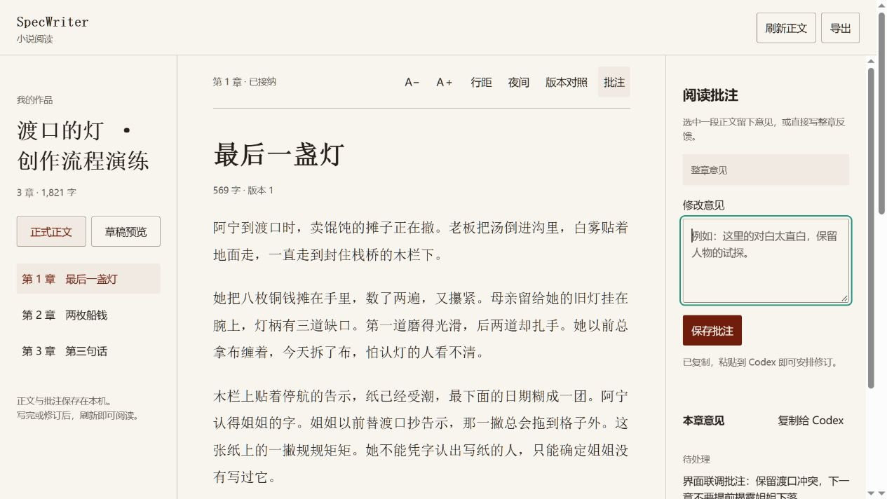

# v0.8 功能边界与交互审计

日期：2026-10-12。被检查的实现版本：`e63ebdd`（v0.8.0）。

结论：新书的逐章创作、正式记忆、阅读与批注、按授权修订接纳已连接；所有业务边界尚未覆盖。历史修订包完成判断与回溯采用约定有可复现的缺口，作者新指示与批注落实也缺少可追踪的交接记录。当前不能承诺真实长篇完全不跑偏。

## 1. 作者、阅读器与 Codex

也可以在 Codex 中直接要求“按阅读批注修订第 N 章”，由 Skill 读取本书文件。页面保存意见不会主动发送消息、唤醒 Codex、暂停写作或接纳正文。“复制给 Codex”是剪贴板桥接，作者把修订请求提交到对话后才启动修订。

批注保存在 `specwriter/feedback/<UUID>.json`，包含：

- `chapterKey`：`accepted:N` 或 `draft:work:N`，区分正式正文与工作包草稿。
- `bodyHash`、正式 `revision`（草稿为空）：绑定意见对应的正文。
- `start/end/quote`：精确字符偏移和原文引用，区分重复段落。
- `note`、`status`：作者意见与 open/resolved 处理状态。

保存时正文已变化则拒绝；已有批注会标 outdated。过期不等于已处理，旧偏移不能直接套用新正文。阅读、批注和导出不调用模型、不修改正式记忆；正式页面读取 SQLite 已接纳正文，磁盘投影的直接修改不等于接纳。

Codex 通过 `feedback list` 核对意见，必要时重新定位旧引用。修订后重新提取、审阅和 verify，依据接纳授权 commit；处理意见用 `feedback resolve` 标记。页面也可标记已处理/重新打开，但该状态本身不能证明意见已经落实到正文。

实现依据：[reader.ts](../packages/specwriter/src/reader.ts)（147–175）、[reader.js](../packages/specwriter/assets/reader/reader.js)（182–192、228–232）、[修订 Skill](../packages/specwriter/assets/skills/specwriter-revise/SKILL.md)、[阅读协议](../packages/specwriter/assets/reader.md)。

本轮在 Temp 创建静态三章样例，实际打开页面、保存整章批注、点击复制，随后通过 CLI 读取到同一批注及生成的请求。页面截图如下；这不代表已完成真实 Codex 自动修订或全部 DOM 交互测试。

## 2. 各类资料怎样组织

| 层 | 保存与生产方式 | 本章使用方式 |
| --- | --- | --- |
| 用户指示 | 当前对话，由 Codex 转写到工作 proposal、章纲或 Specs；授权另存 work policy | 尚无独立指示登记簿，转写正确性依赖 Skill |
| 创作约定 | premise/world/characters/style 四份 Markdown，经 contract adopt 保存 SQLite 内容快照 | 按章节选择已采用版本，四份完整内容受预算保护；只编辑草案不会生效 |
| 未来计划 | specwriter/plans 下全书和近期计划 | intent.planPaths 显式选择；可按预算截断，标明不是已发生事实 |
| 工作意图与章纲 | 工作 proposal.md；每章 intent.json 校验后生成 intent.md | 目标、场景、人物/POV、时间、必选状态/事件/伏笔、认知、暂不揭露、预期变化等 |
| 正式长期记忆 | 已接纳正文及 memory-delta 存入 SQLite，按章重放 | 稳定实体、事实/角色认知、状态、事件因果、资源余额、伏笔、时间线、摘要 |
| Microsoft GraphRAG | 从正式有效前缀正文独立构建可重建索引；Qwen 索引/查询，BGE-M3 本地向量 | 辅助召回答案及原文来源；不直接把自动图谱当正式事实 |
| 本章资料包 | 工作目录每章 context.json | 汇总采用约定、当前章纲、关键正式记忆、相关检索、计划和原文；绑定版本与哈希 |

SQLite 的正式记忆与 Microsoft 自动抽取的图谱是两层。前者从逐章证据支持的 delta 重放，承担状态与一致性规则；后者用于找旧情节与关系。GraphRAG 的回答不直接入正式库。每本书有独立正文、数据库、GraphRAG 快照、授权和批注；运行环境与本地 embedding 模型可共用。

## 3. 第 N 章的上下文怎样生成

1. 检查工作包范围、作者授权、暂停状态、采用的约定和保存的章纲。
2. 检查前文是否为连续有效正式版本；准备第 N 章只重放第 1 至 N−1 章。存在缺章或 stale 后文时不能越过继续。
3. 用本章目标、人物、状态/资源、认知、事件和伏笔生成检索问题。Microsoft 语料仅包含该边界内已接纳正文，不包含 Specs、计划、草稿和 stale 后文。
4. 固定保留采用的四份约定、工作意图、章纲、已登记参与人物/POV 的关键状态与余额、显式必选依赖，以及上章末尾 3000 个 JavaScript 字符。必要内容超过预算就拒绝，不静默丢弃。
5. 其余事实、事件、实体、伏笔、摘要、时间线和原文按相关性及预算选取；还结合本地结构化图的两跳关系。未选中记录留在永久记忆，可追加查询或读原文。
6. 核对 GraphRAG 的引用映射及可识别状态冲突；通过当前检查的答案与相关原文可进入资料包，未通过回答被排除并要求审阅正式记忆。
7. 输出 context.json，Codex 通过 Skill 实际读取它后写正文。默认预算为 30000 字符的序列化资料包，不是模型 token 配额。

**context.json 是写作资料包，不是 CLI 对 Codex 实际模型上下文的强制替换。** Codex 仍处在当前对话中，系统不能验证它读完了每项资料，也不能保证模型只依据这些资料生成。程序能验证资料版本和接纳边界；指令遵从与文学判断仍需实际审阅。

来源：[project.ts](../packages/specwriter/src/project.ts)（52、252）、[workflow.ts](../packages/specwriter/src/workflow.ts)（99、102）、[WriterMemory](../packages/specwriter/src/writer-memory.ts)、[Microsoft 适配器](../packages/specwriter/src/microsoft-graphrag.ts)。

## 4. 已实现的保护及其范围

| 边界 | 已有实现 | 不能据此推出 |
| --- | --- | --- |
| 前文与未来分开 | trustedPrefix、N−1 重放、默认检索前缀隔离；旧章正文接纳后标后文 stale | 作者知识与角色知识已实现完整语义推理 |
| 采用版本 | adopted contract 快照、按章生效；草案编辑不会偷偷改变约定 | 显式回溯采用已触发历史协调，见下一节 |
| 当前章任务 | 工作 ID、章节号、intentHash、输入指纹、contextHash、baseRevision | 当前聊天的所有新要求都已落盘 |
| 中途变化 | 索引/查询前后检查 generation、输入和授权；变化不发布旧 context | 页面批注会自动打断正在写作的 Codex |
| 重新审阅 | 正文、章纲、上下文变化会使提取/审阅失效；verify/commit 重验 | 审阅中的 supported/satisfied 一定语义正确 |
| 状态一致性 | 稳定人物 ID、唯一关键状态、old_value、资源算术、事件/伏笔依赖等 | 所有正文中的变化都被完整提取 |
| 接纳控制 | 范围、draft/auto、暂停在 prepare/commit 检查 | 页面“已处理意见”等于正文已修订 |
| 交付 | 导出只连续有效正式前缀，stale 可阅读但有警示 | 所有历史任务包完成判断都正确，见下一节 |

哈希检查位于 [project.ts](../packages/specwriter/src/project.ts)（409–465），状态重放位于 [memory.ts](../packages/specwriter/src/memory.ts)，正文接纳失效机制位于 [store.ts](../packages/specwriter/src/store.ts)（169–177）。

## 5. 未覆盖的高优先级边界

### 5.1 历史修订工作包可能被误判已完成

隔离复现：接纳第 1–2 章后，新建仅修订第 1 章的工作包。尚未 prepare 或写修订，resume 已返回 complete、tasks.md 已勾选，archive 也成功。已完成工作包存在尚未接纳的新修订草稿时也能被归档。

原因：恢复、任务投影与归档主要根据全书已有可信章节判断完成，未统一检查该工作包的实际修订接纳进度与 pending 候选稿。候选内容不会被删除，但工作包会提前关闭，之后不能继续从该包接纳。

来源：[project.ts](../packages/specwriter/src/project.ts)（186–188、561–562）、[projections.ts](../packages/specwriter/src/projections.ts)（42）。

应统一工作包完成判定：新写、历史修订和协调任务各自记录实际完成条件；有未接纳候选时阻止归档，并补充恢复/归档回归用例。

### 5.2 回溯采用 Specs 没有历史待协调状态

隔离复现：接纳“晴天点灯”的前两章后，把约定改为“只能雨中点灯”，执行 contract adopt --from 1。第 1 章有效约定已更换，但 stale 仍为空，memoryThrough 仍为 2，语料及 TXT 导出含旧正文，任务继续指向第 3 章。

默认从下一章采用约定是正常的；采用也不应直接重写正文。问题是显式回溯后没有待核对状态，旧正文可以未经协调继续作为前提。

来源：[workflow.ts](../packages/specwriter/src/workflow.ts)（22–32）、[store.ts](../packages/specwriter/src/store.ts)（106–110）。

应记录回溯影响并从相应章节顺序核对，按作者授权修订或确认兼容；保留旧正文，阻止使用未经协调的后文推进。

### 5.3 最新作者指示没有独立交接记录

work authorize.reason 保存授权依据，但不进入 context.sources。用户说“禁止新增感情线”等要求，若只留在聊天或 reason，Codex 未同步 proposal/intent/已采用 Specs，CLI 无法知道指示遗漏，也不会让旧 context 必然失效。

应把创作指示与接纳授权分开：记录本书指示 ID、内容、适用章节、采用状态和版本，纳入当前资料包指纹与审阅要求。draft→auto 的授权变化不应无故重做已经有效的文学审阅。

来源：[workflow.ts](../packages/specwriter/src/workflow.ts)（38–47）对比 [project.ts](../packages/specwriter/src/project.ts)（52–63、99–101）。

### 5.4 批注没有可靠的落实状态与推进策略

保存批注不会自动进入 prepare，也没有未处理批注门禁。作者边读边批注时，Codex 可继续原有自动接纳范围；作者要在对话中提出暂停。当前只有 open/resolved，没有采纳/拒绝/需澄清及理由，也没有“由哪次正文修订落实”的绑定。

建议增加意见处理记录、采用的意见 ID/版本及应用修订；在 resume 展示新意见，由作者选择普通待办或阻塞写作的修改。无需把每条措辞建议都自动变成强制暂停，也不必立即引入复杂消息服务。

复制请求应包含 bookId、书名与小说目录，降低多书并行粘贴错对话的风险。未保存输入目前只在页面内存暂存，重载或关闭会丢失；可加入本地意见草稿保存。

## 6. 语义与长篇质量仍须验证

- GraphRAG assessment.accepted 只表示通过当前引用映射和有限冲突规则。规则主要覆盖位置、生死、境界、真实身份与余额句式，不做逐句语义蕴含证明。真实引用仍可能被错误总结成虚构因果或角色获知过程。
- intent_checks 当前独立强制项只有 goal、knowledgeChecks、withhold。场景、POV、故事时间、预期变化、目标字数与各项 Spec 硬约束仍主要靠 Codex 的 coverage/continuity 审阅。withhold 可用核对说明而无直接引用。
- 旧情节可通过必选事件/伏笔 ID 固定保留，通过 GraphRAG 和原文追加召回，但前提是正确提取并选出相关依赖；不能承诺所有前文每次都召回。
- 当前记忆可以保留作者视角的世界真相；world/belief 分离与 holder 查询不等于自动隔离角色所有未知内容。
- 自动卷回顾、整书完结检查、整本导入、真实长篇及百万字质量验证仍未完成。

来源：[memory-policy.ts](../packages/specwriter/src/memory-policy.ts)（58–127）、[workflow.ts](../packages/specwriter/src/workflow.ts)（141–145）、[验证范围](v0.8-workflow-validation.md)。

## 7. 本轮验证与下一版顺序

本轮完成 Git 提交及差异检查、三个方向的源码与既有测试审计、阅读器页面保存/复制状态及 CLI 读取联调、两处业务缺口的 Temp 零模型复现。先前记录的 96 项回归通过属于已有机制验证，本轮未重复执行整套测试。没有调用付费 Qwen、真实 Microsoft GraphRAG 建库、长篇生成或独立文学评测；页面联调也未覆盖所有选段、剪贴板与切章竞态。

建议下一版按以下顺序实施：

1. 修复历史修订包恢复/完成/归档判定，以及回溯采用 Specs 的历史协调。
2. 接通作者指示记录与批注处理、上下文失效和审阅核对，补齐多书身份。
3. 补充可审阅的 POV、场景、揭露、硬约束与预期变化核对，保留合理创作自由。
4. 用真实 3–6 万字、多轮作者修改和旧情节回调做独立评审，再推进百万字实验。分别报告机制成功率、指令遵从、情节召回、认知泄漏、矛盾和文学质量。
