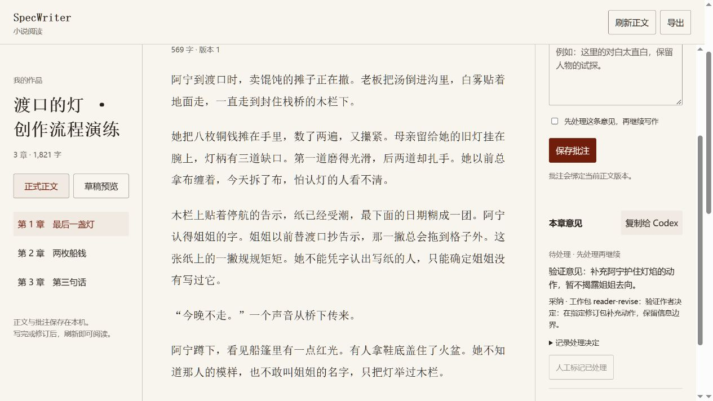

# v0.9 作者指示与批注交接验证

## 本版范围

独立有范围的作者指示、批注取舍和引用定位、采纳快照进入上下文/审阅、正式落实 revision、阻塞反馈门禁；另修复历史工作包完成/归档和追溯采用 Specs 的协调边界。

context.json 供 Codex 按 Skill 读取，CLI 不控制真实模型上下文。引用/哈希约束资料及接纳，不证明读完材料、语义正确或文学质量。fixture 流程结果不能写成长篇召回/文学实验。

## 验收目标

| 边界 | 验证行为 |
| --- | --- |
| 作者指示 | 章节/工作包范围、require/avoid检查、资料与指纹绑定，不替代授权 |
| 指示变化 | 新增/停用使待写包过期，历史书籍范围需重审，旧快照保留 |
| 反馈取舍 | adopt/decline/clarify需理由，采纳目标active且覆盖章 |
| 旧意见 | outdated不套旧偏移，anchor匹配当前来源，原引用保留 |
| 落实 | 采纳快照与审阅绑定，草稿不标正式落实，接纳绑定revision，失败可reconcile |
| 已落实意见 | 不直接reopen已applied意见；新建意见承载后续修改，旧落实版本保留 |
| 阻塞 | 作者选择，挡后续而允许精确目标修订，manual resolve不绕过 |
| 身份 | 复制带name/bookId/root，不主动发送消息 |
| 异步变化 | 准备期间指示/阻塞反馈变化不发布旧包 |
| 历史任务 | 历史草稿不误挡完成，真正不同草稿可显式选择 |
| 追溯约定 | 受影响章需协调，不把后文当当前事实 |
| 安装兼容 | 老批注/老小说可读，升级保留作者改写Skills，命令一致 |

## 本轮实际结果

在 Windows 的隔离工作副本中，全量回归 **121/121 通过**，其中 v0.9 专项 25 项：生命周期 6 项、反馈 9 项、作者指示集成 10 项。涵盖 CLI、HTTP、版本/授权门禁、指示与反馈快照、旧章协调和故障恢复。在实际 SpecWriter 目录合入后，最终全量回归同样 121/121 通过，耗时约 151 秒；类型检查和 diff --check 通过。v0.8 的 96 项测试和三章静态演练见 [历史记录](v0.8-workflow-validation.md)。

8 个 Skills 均通过 skill-creator 的 quick_validate；包含两份安装指南和截图的 8 份主文档共 43 个相对链接有效，代码围栏成对，无替换字符。格式校验不证明模型决策或创作质量。

另用独立子代理进行只读协议场景检查：给定过期 blocking 批注、仅草稿授权和“所有未来修订不得提前揭露”的作者要求，检查结果正确区分重新定位、目标修订包采纳、书籍长期指示、草稿不算正式落实、后续章节仍受阻。这是文本决策审查，没有执行小说改写或模型 API，不是端到端创作质量验证。

真实本地浏览器检查使用三章静态样例：正文合计 1927 个 UTF-16 字符，阅读器按去空白 Unicode 码点显示 1821 字，模型调用为 0。检查通过：未提交的意见文本和 blocking 勾选在刷新后恢复；保存后输入清空并显示待处理阻塞意见；页面采纳到 reader-revise 并展示理由；“复制给 Codex”包含书名、bookId 和小说目录。截图如下；本检查验证阅读交接，不是实时消息推送、自动生成小说或文学盲评。

从实际项目生成最终 `specwriter-0.9.0.tgz`，在临时目录离线安装和覆盖升级均成功，安装 7 个依赖。通过可执行入口 init 创建独立小说，生成 8 个 Skills，doctor 显示 healthy，instruction add 可用。没有发送 Qwen 建库/检索请求，也没有下载或重新验证本地模型权重。

## 尚未验证

真实 3–6 万字持续创作、远距离召回、百万字性能、指令遵从盲评、文学质量尚未验证；自动卷回顾、完结检查、整书导入与独立无人值守服务也不属于本轮。
